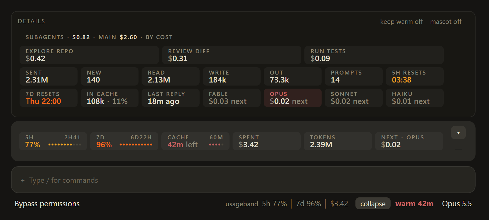
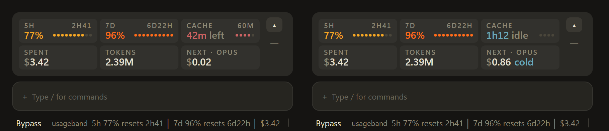

# usageband

Your Claude Code usage at a glance: how much of the 5-hour and 7-day limits you have used, whether the prompt cache is warm, what the next message costs, and what the session has spent.



## What it shows

**Footer line.** Always on, next to the model name, and it takes no space:

```
usageband 5h 23% used, resets 2h41 │ 7d 4% used, resets 6d22h │ $3.42   [collapse] warm 42m
```

The status part shows how much of the 5-hour and 7-day limits is used (as Claude Code counts it), when each resets, and the money spent this session. After the button, the cache shows its countdown in red while warm and its idle time in blue once cold.

**Band.** Six chips above the prompt. They reflow into rows as the pane narrows.

| Chip | Shows |
|---|---|
| 5H | Share of the 5-hour limit used, and the time to its reset (always shown; cut to hours in tight panes) |
| 7D | Share of the 7-day limit used, the time to its reset, and HIGH from 85% used |
| Cache | Minutes left while warm (red), idle time once cold (blue) |
| Spent | What the session has cost so far |
| Tokens | Every token the session has processed |
| Next | What one more message costs now on your model |



**Details menu.** Opens upward from the band, so the band and the prompt stay where they are.

- Next-message price on each model: Fable, Opus, Sonnet, Haiku
- Tokens: sent, new (not from the cache), cache read, cache write, out
- Prompt count, reset times, tokens in the cache
- Subagents in their own card, by name and cost, with their own pager: paging moves only them, never the fixed figures. A name too long for its chip is cut; hover it for the whole. Runs with no task name (the engine's own work, such as compaction) show together as one "unnamed" chip
- Keep warm: a timer that keeps the prompt cache warm while you are away (see below)
- An optional pixel mascot for the cache chip, off by default

## Controls

| Control | Where | Does |
|---|---|---|
| expand / collapse | Footer | Shows or hides the band |
| ▴ / ▾ | Band | Opens or closes the details menu |
| ━ | Band | Hides the band |
| Keep warm | Details header | Starts or stops the keep-warm timer; highlighted while it runs |
| length picker | Details header | Sets the timer's length: 4h, 8h, 12h, 24h, or custom (1 to 72 hours); starts nothing |
| mascot | Details header | Shows or hides the mascot; tinted while it shows |
| `/band` | Prompt | Shows or hides the band |

## Keep warm

A cold cache makes the next message re-write the whole context at twice the input price. A warm one only reads it. On Opus, one cold send costs as much as about 40 reads, so keeping the cache warm while you step away is cheap next to coming back to a cold one.

Set a length in the picker in the details header: 4h, 8h, 12h or 24h, or **custom** to type any number of hours from 1 to 72 and press Enter. The length is remembered for later sessions. Press **Keep warm** to start the timer, and press it again to stop it. Until the timer runs out, the mod sends one short line ("cache ping, reply ok") as soon as 2 minutes or less are left on the 1-hour cache (58 minutes after the last request). It checks every 10 seconds, so it has 12 chances to catch that window. While it runs, the footer shows `kw` and a pill beside the picker shows the time left and the pings sent. A new length picked while it runs takes effect from that moment. The phone app has no picker: there the button runs the length last picked.

It stops on its own, and shows why, when:

- the timer runs out;
- the pings have cost as much as one cold send (past that, letting the cache go cold is cheaper: about 38 h of pings on Opus, 18 h on Sonnet);
- a cold send would cost under $1 (small contexts are not worth keeping);
- the 5-hour limit is over 90% used or the 7-day limit over 95%;
- a ping wrote the cache instead of reading it (the cache had already expired, or the session is on the 5-minute cache of usage overage).

It never pings while a turn is running, and pings do not count as your prompts. Check the logic: `npx -y tsx tests/keepwarm.check.ts`. Check the menu's controls on each surface: `claude plugin test`.

## Install

In Claude Code:

```
/plugin marketplace add daTuzzo/usageband
/plugin install usageband@usageband
```

Then start a new session.

## Updates

Claude Code does not update plugins from a GitHub marketplace on its own unless you turn it on. Do that once: run `/plugin`, open **Marketplaces**, pick **usageband**, and choose **Enable auto-update**.

Without it, usageband tells you itself. Every session checks GitHub for a newer version, at the start and every 6 hours. When one exists, the footer line ends with `update 0.17.0` and the details header shows an **update to 0.17.0** button. The button runs Claude Code's own update commands, and new sessions load the new version. If it cannot run them, it shows the command to run yourself: `claude plugin update usageband@usageband`.

## Notes

- Prices are Anthropic API list prices per million tokens. A subscription bills differently, so read the dollar figures as what the same work would cost on the API.
- The cache counts as warm for 60 minutes after the last request, the lifetime of the cache Claude Code uses.
- "New" input is small by design: Claude Code serves almost the whole prompt from the cache on every request.
- Subagent costs are priced from each subagent's own token counts. The session total is the engine's own figure.
- The drawn band needs the desktop app. The terminal gets a text version of the same figures.

## License

[MIT](LICENSE)
